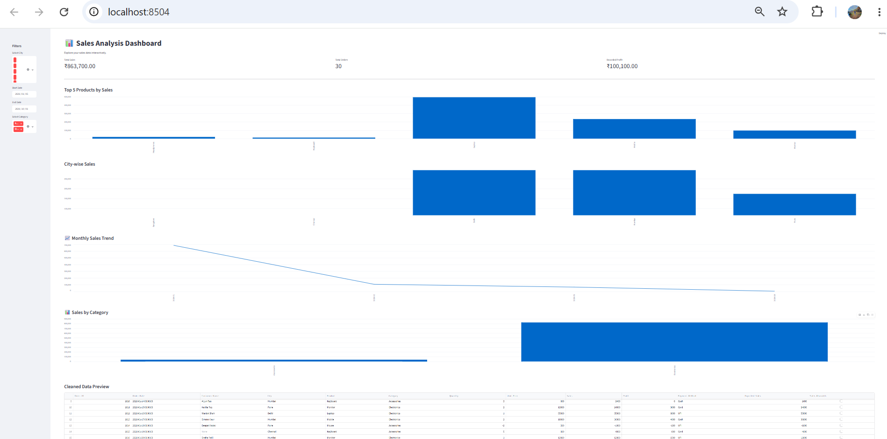

Sales Data Analysis Dashboard
Project Overview

An interactive sales analysis dashboard built using Python, Pandas, Matplotlib, and Streamlit.

Features
Data cleaning and preprocessing
Sales and profit analysis
Product-wise and city-wise sales comparison
Interactive filters
CSV data download
Technologies Used
Python
Pandas
Matplotlib
Streamlit
How to Run
Install dependencies using pip install -r requirements.txt
Run streamlit run app.py
Open the local URL displayed in the terminal.
Data Note

Profit figures depend on the completeness and accuracy of the source data. Any simulated cost assumptions should be documented clearly.

## 📊 Dashboard Preview

